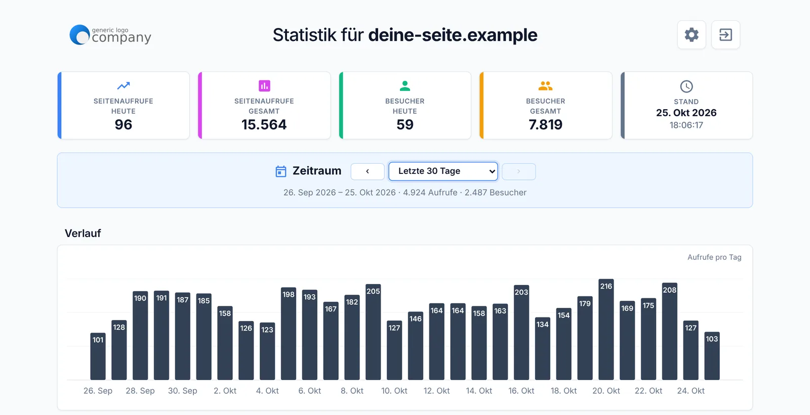

# websimon-stats

**Lightweight visitor statistics for PHP websites – no cookies, no database, no Google.**

[Deutsche Version](README.de.md) · [Live demo](https://websimon.de/demo/)



## Features

- **No cookie banner needed:** no cookies, nothing is stored on your visitors' devices
- **No IP addresses:** visitors are counted with an anonymous ID that changes every day
- **Server-side counting:** works without JavaScript, not affected by ad blockers
- **No database:** upload a folder, add one line, done
- **Filters bots** from search engines, link previews and scripts
- **Reports:** page views and visitors, history by day, week and month, referrers, browsers, operating systems, devices, languages, top pages
- **PDF report** for any period
- **Password protected**, with a lockout after too many failed attempts
- **6 languages** (English, German, Spanish, French, Italian, Dutch), light and dark mode
- All data stays on your own web space

## Requirements

- Web space with **PHP 7.4 or newer** (tested with PHP 8.3)
- Apache, nginx, LiteSpeed or IIS – no `.htaccess` and no server configuration needed
- The statistics folder must be **writable** by PHP (usually the case by default)

## Installation

1. **Download:** click **Code → Download ZIP** at the top of this page and unzip the file.
2. **Upload:** upload the **`stats`** folder via FTP (e.g. WinSCP or FileZilla) to the root folder of your website. You may rename the folder.
3. **Set a password:** open `https://your-site.com/stats/` in your browser. On the first visit you choose a password (at least 8 characters). Only a hash of it is stored.
4. **Add the counter:** in the statistics, click the gear icon at the top right. Under **“Count page views”** you will find the ready-made line for your site, e.g.:

   ```php
   <?php if (is_file($_SERVER['DOCUMENT_ROOT'] . '/stats/track.php')) { include_once $_SERVER['DOCUMENT_ROOT'] . '/stats/track.php'; } ?>
   ```

   Put this line at the **very top** of every PHP page you want to count – before `<!DOCTYPE html>`. If all pages share a common header file, adding it there once is enough.
5. **Test:** open one of your pages, then reload the statistics – the visit should show up.

> **Plain HTML pages without PHP?** An invisible image can count instead:
> ``
> The server-side PHP line is more accurate, though.

## Settings

Everything important is set right in the statistics (gear icon at the top right):

- **Appearance:** light, dark or system
- **Language:** otherwise taken from the browser
- **Keep data:** 3, 6, 12 or 24 months – older visits are deleted automatically
- **Filter bots:** visits without a browser language are not counted (recommended)

**Your own logo:** put a file `logo.png` (about 260 × 64 pixels) into the statistics folder. Optionally add `logo-dark.png` for dark mode.

**Another language:** copy a file in `stats/lang/`, e.g. `en.php` → `pt.php`, and translate the texts. The language then shows up in the selection automatically.

## Privacy

The statistics set no cookies and read nothing from your visitors' devices. They only evaluate what every browser sends anyway and store no IP addresses. In most cases this means no cookie banner is required.

**It still belongs in your privacy policy.** The German README contains a sample text. *This is not legal advice – have your privacy policy checked if in doubt.*

## Updating

Replace all files in the statistics folder with the new ones – **except** these, which contain your data:

- `config.php` (password and settings)
- `visits.log.php` (the counted visits)
- `login-attempts.php`
- `logo.png` / `logo-dark.png`, if present

## Support

websimon-stats is free and provided as is – **without support**. I'm happy to read bug reports but can't promise an answer.

Like the script?

<a href="https://ko-fi.com/G7N629I3TR"></a>

## License

[MIT](LICENSE) – free to use, modify and share, including for client projects, as long as the license notice is kept.

© 2026 Ralf Simon, [websimon.de](https://websimon.de)
